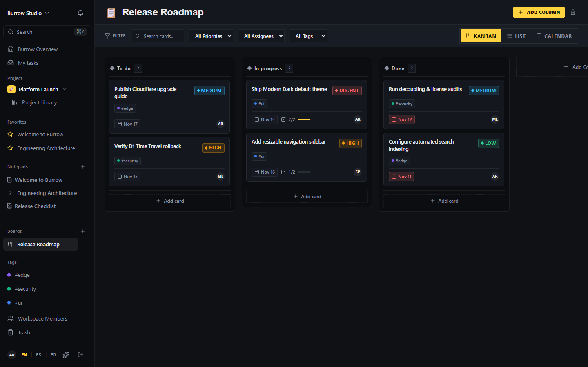
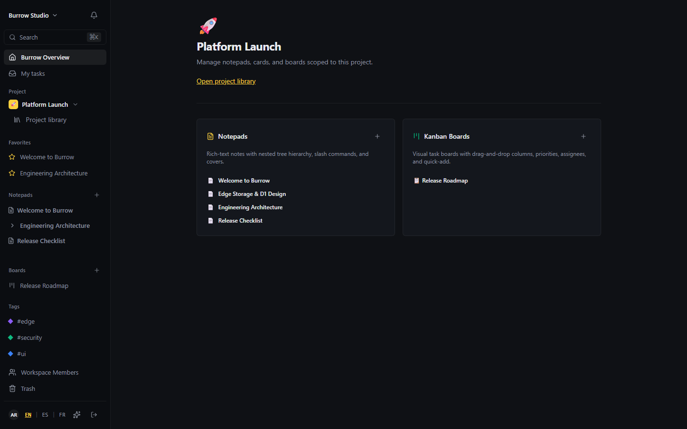
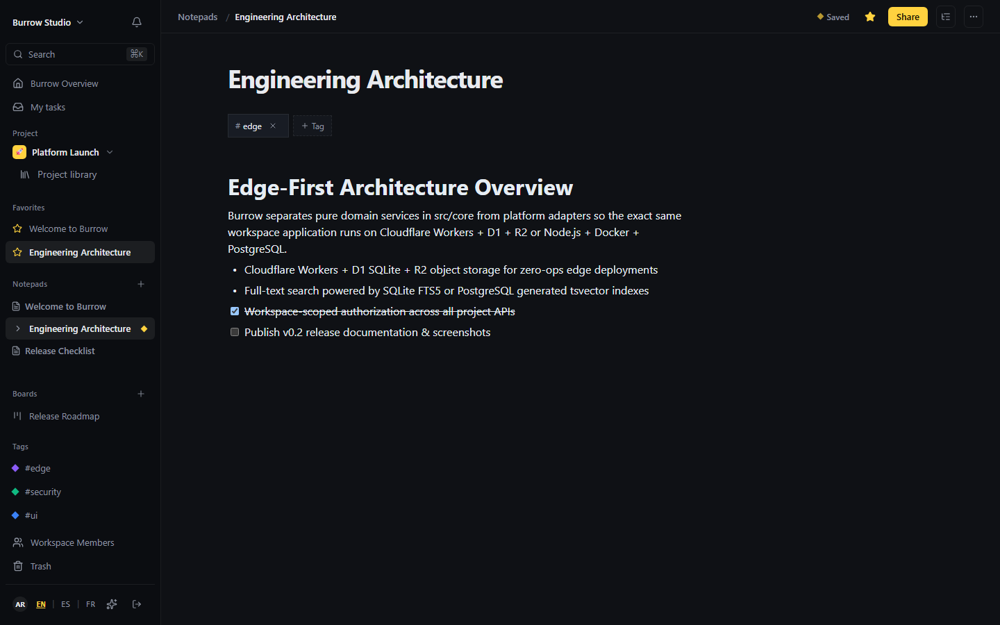
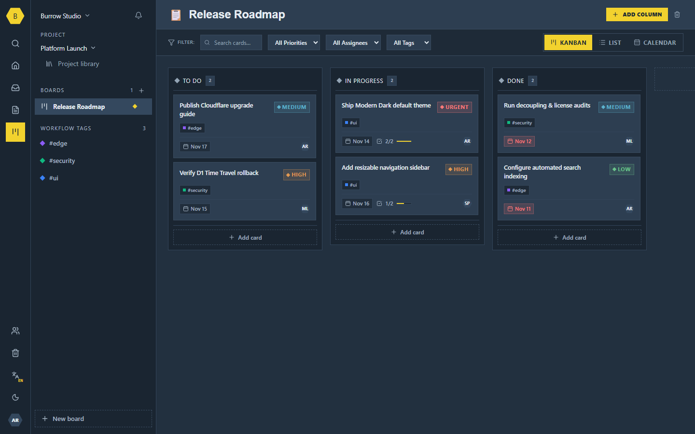
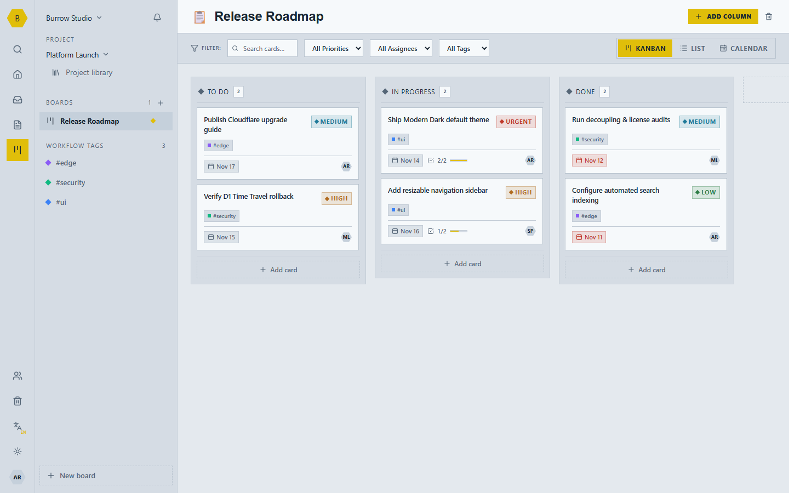
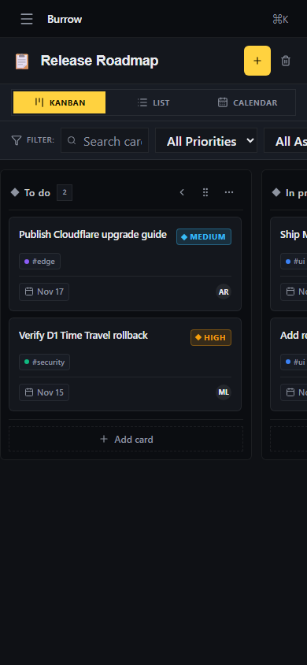

# Burrow

**Fast, open-source (AGPL-3.0), self-hostable shared team workspace for rich notepads, Kanban boards, and file storage — engineered for Cloudflare Workers + D1 + R2 and Docker + PostgreSQL.**

[](LICENSE)
[](https://www.typescriptlang.org/)
[](https://react.dev/)
[](https://hono.dev/)
[](https://www.blocknotejs.org/)
[](https://vite.dev/)
[](https://workers.cloudflare.com/)
[](./docker-compose.yml)

---



---

## Why Teams Self-Host Burrow

Burrow focuses on doing three things cleanly—**rich block notepads, multi-view task boards, and project file storage**—without artificial paywalls or heavy infrastructure:

- **Zero per-seat caps:** Invite your whole team (`owner`, `editor`, `viewer` roles) with unlimited seats, workspaces, and projects out of the box (unlike AppFlowy's 1-seat limit and AFFiNE's 10-seat cap on free self-hosted tiers).
- **Uncapped Kanban, List & Calendar views:** Switch freely between drag-and-drop Kanban boards (with WIP limits), tabular List view, and drag-and-drop Calendar view in the core AGPL-3.0 release (unlike Docmost's paid tier for Kanban).
- **Native email & password auth:** Boots ready with built-in email/password authentication via [Better Auth](https://www.better-auth.com/) and zero-trust `BOOTSTRAP_TOKEN` owner claiming—no external Keycloak, Authentik, or OIDC server required (unlike Outline). Optional Magic Link (`RESEND_API_KEY`) and Google/GitHub OAuth stay hidden unless configured.
- **Lightweight Cloudflare or Docker hosting:** Deploy serverless inside Cloudflare's free-tier limits (**Workers + D1 + R2**), run **Docker Compose + PostgreSQL 17**, or develop locally on **SQLite** with zero telemetry.

> **Honest scope:** Burrow is a focused team workspace for notepads, Kanban/List/Calendar boards, and files—it does **not** include Notion-style relational databases or simultaneous CRDT real-time co-editing (notepads use lease-based edit locking so teammates take turns safely without conflicting overwrites).

---

## Try the Live Demo

Explore a live instance hosted on Cloudflare Workers, D1, and R2 (reset automatically every 2 hours):

- **URL:** <https://burrow.osscafe.com>
- **Email:** `demo@osscafe.com`
- **Password:** `demopassword123`

> Prefer to jump straight to installation? See [Quick Start](#quick-start) or the full [Deployment & Upgrades Guide](docs/DEPLOYMENT_AND_UPGRADES.md).

---

## Core Features & Benefits

- **Workspaces & Scoped Projects**: Organize teams, notes, boards, and media cleanly inside isolated workspaces and projects (`owner`, `editor`, `viewer` roles).
- **Rich Block Notepads & Nested Pages**: Slash commands, checklists, code blocks, callouts, embedded media, document outlines, and hierarchical sub-pages. Uses lease-based document edit locking so team members take turns editing a notepad safely without conflicting overwrites (rather than simultaneous real-time co-editing).
- **Kanban, List & Calendar Views**: Drag-and-drop cards across columns with WIP limits, priorities, due dates, subtasks, tags, comments, and quick-add shortcuts.
- **Instant Full-Text Search (`Cmd+K` / `Ctrl+K`)**: Command palette backed by SQLite FTS5 or PostgreSQL `tsvector` indexes across notepads and board cards.
- **Integrated File & Media Library**: Upload images, videos, and project attachments to **Cloudflare R2**, **S3-compatible storage**, or **local disk** with automatic quota and type validation.
- **Multilingual & Themeable UI**: Instant client-side switching across **English**, **Spanish**, and **French**, plus three curated built-in themes (`Modern Dark`, `Basalt Dark`, `Basalt Light`).

<details open>
<summary><strong>Screenshots: Workspace Dashboard & Nested Document Editor</strong></summary>





</details>

---

## Quick Start

### Prerequisites

- **Node.js `^20.19.0` or `>=22.12.0`** (required by Vite 8) and **pnpm 10+** (or **Docker** for container self-hosting)
- A **Cloudflare account** (for edge deployment with [R2 Object Storage activated](docs/DEPLOYMENT_AND_UPGRADES.md#prerequisites))

### Deploy to Cloudflare in 4 Commands

```bash
git clone https://github.com/Open-Source-Solution-Cafe/Burrow.git
cd Burrow
pnpm install
pnpm run setup -r
```

The interactive 10-stage setup verifies your environment, authenticates Wrangler, provisions D1 and R2 if missing, applies SQL migrations safely, deploys the Worker + SPA, configures Worker secrets, verifies live health/auth endpoints, and displays your **Production URL** alongside a one-time **`BOOTSTRAP_TOKEN`** printed only on initial setup so you can register the first Owner account (`BETTER_AUTH_SECRET` is never printed to logs or stdout).

### Try Locally in Development

```bash
pnpm run setup
pnpm dev
```

Runs the API + React app locally using SQLite (`./data/burrow.db`) and local file storage (`./data/uploads`) with zero cloud dependencies.

---

## Deployment Options

### Option A: Cloudflare Edge (Workers + D1 + R2)

Best for zero-maintenance hosting inside Cloudflare's free-tier limits.

- **First-time install or safe retry**: `pnpm run setup -r`
- **Custom domain** (on Cloudflare DNS): `pnpm run setup -r -- --domain notes.example.com`
- **Dry-run preview** (prints all 10 stages cleanly): `pnpm run setup -r -- --dry-run`
- **Safe upgrades**: `git pull && pnpm install && pnpm run deploy` (records a D1 Time Travel bookmark before running migrations, preserves all Worker secrets, and verifies `/api/health`, `/api/auth/config`, `/api/system/version`, and `/` post-deploy).

> Curious about Cloudflare's native one-click deploy button? Read our engineering assessment in [Native Deploy Button Feasibility](docs/CLOUDFLARE_DEPLOY_BUTTON.md).

### Option B: Docker & PostgreSQL

Best for self-hosted servers, VPS environments, and Docker Compose stacks.

**Local Docker evaluation (`http://localhost:3005`, bound strictly to `127.0.0.1`):**

```bash
pnpm run docker:init -- --local-eval
docker compose up -d --build
```

> `pnpm run docker:init -- --local-eval` generates unique stable `.env` secrets and displays your one-time `BOOTSTRAP_TOKEN` cleanly without printing secrets into production container logs.

**Production Docker deployment (internet-accessible):**

```bash
pnpm run docker:init -- --url https://notes.example.com
# Place Caddy / Nginx / Traefik in front of 127.0.0.1:3005 (or set BIND_HOST intentionally)
docker compose up -d --build
```

Includes **PostgreSQL 17**, automatic schema migrations on boot, full-text search via PostgreSQL `tsvector`, and optional S3-compatible object storage. See [Deployment & Upgrades](docs/DEPLOYMENT_AND_UPGRADES.md#option-2-docker--postgresql-self-hosting) for reverse-proxy, environment, and upgrade steps.

---

## Internationalization & Themes

- **Languages**: Built-in **English (`EN`)**, **Español (`ES`)**, and **Français (`FR`)** with one-click switching in the sidebar footer and login screen.
- **Themes**:
  - **Modern Dark** *(Default)* — Sleek dark workspace with a drag- and keyboard-resizable navigation sidebar (`200px`–`480px`).
  - **Basalt Dark** — Industrial two-tier dark rail and compact workspace density.
  - **Basalt Light** — High-contrast warm paper & ink light theme.
- **Responsive Mobile Layout**: Collapsible navigation drawer and mobile-adapted board/editor controls.

<details>
<summary><strong>Screenshots: Basalt Dark, Basalt Light & Mobile Responsive Layout</strong></summary>







</details>

---

## Architecture Overview

Burrow is structured as a hexagonal core decoupled from runtime storage and transport:

```text
src/
├── core/        # Domain services, Hono routes, repositories & infrastructure contracts
├── worker/      # Cloudflare Workers entrypoint + D1 / R2 adapters
├── server/      # Node.js / Docker server + SQLite / PostgreSQL + S3 / local disk adapters
└── web/         # React 19 + TanStack Router + BlockNote + Tailwind CSS SPA
```

This separation lets you run the exact same application locally on SQLite, on Cloudflare's edge with D1 + R2, or in Docker with PostgreSQL — with schema parity tests enforcing behavioral consistency across runtimes.

---

## Security & Privacy

- **Zero-Trust First-Boot Claim**: Initial Owner registration requires `BOOTSTRAP_TOKEN` paired with an atomic email reservation in `bootstrap_state`, preventing drive-by account takeovers on newly deployed public instances. Subsequent users require explicit workspace invitations.
- **Strict Workspace & Project Isolation**: Every resource endpoint enforces workspace membership and role checks before returning data or generating media URLs.
- **Hardened HTTP & Auth Defaults**: Powered by [Better Auth](https://www.better-auth.com/) with CSRF origin checks, security headers, body size bounds, safe upload validation, and optional Magic Link (`RESEND_API_KEY`) or Google/GitHub OAuth (completely hidden when unconfigured).
- **Minimal Terminal Secret Exposure & Zero Telemetry**: Cryptographically random `BETTER_AUTH_SECRET` signing keys are uploaded directly to encrypted Cloudflare Worker secrets and never printed. The one-time `BOOTSTRAP_TOKEN` is shown once in the interactive initial-setup summary (preserved without reprinting on upgrades unless `--rotate-bootstrap-token` is passed) and redacted by the server in production logs. No analytics or telemetry leave your instance.

---

## Documentation, Contributing & Open-Source Commitment

| Guide | Description |
| :--- | :--- |
| [Deployment, Configuration & Upgrades](docs/DEPLOYMENT_AND_UPGRADES.md) | Complete Cloudflare Workers and Docker/PostgreSQL setup, env reference, Time Travel backups, and troubleshooting |
| [Bootstrap Recovery & Migration Checks](docs/BOOTSTRAP_RECOVERY.md) | Recovering interrupted owner setup, preflight data checks, and storage inventory |
| [Cloudflare Deploy Button Assessment](docs/CLOUDFLARE_DEPLOY_BUTTON.md) | Technical evaluation of one-click Cloudflare provisioning requirements |
| [Contributing Guide](CONTRIBUTING.md) | Contribution status, architecture walkthrough, local dev commands, `pnpm run check:sqlite`, and screenshot automation |
| [Changelog](CHANGELOG.md) | Version history and unreleased improvements |

### Permanent Self-Hosted Commitment & License

Burrow is licensed under **[AGPL-3.0-or-later](LICENSE)**. The following core capabilities in this self-hosted codebase will remain **open source and uncapped permanently**—with zero seat caps, feature paywalls, or license-key gates:

- **Unlimited seats & structure:** Unlimited workspace members (`owner`, `editor`, `viewer`), workspaces, projects, boards, and notepads.
- **All board views & task workflows:** Uncapped **Kanban**, **List**, and **Calendar** views, WIP limits, priorities, due dates, subtasks, tags, comments, and `My Tasks`.
- **Rich notepads, search & files:** BlockNote editor with nested sub-pages, document outlines, lease-based edit locking, `Cmd+K` / `Ctrl+K` full-text search (`SQLite FTS5` and `PostgreSQL tsvector`), and file/media storage (`Cloudflare R2`, `S3-compatible`, or local disk).
- **Native auth & runtime portability:** Built-in Email & Password authentication, `BOOTSTRAP_TOKEN` owner setup, invite-only onboarding, optional Magic Link / Google / GitHub OAuth, **English / Spanish / French** UI, all built-in themes, and full support for **Cloudflare Workers (D1 + R2)**, **Docker + PostgreSQL 17**, and **Node.js + SQLite** with zero telemetry.

### Contributor License Agreement (`CLA.md`)

Burrow includes a [Contributor License Agreement (CLA)](CLA.md) so the project maintainers retain dual-licensing flexibility alongside the copyleft `AGPL-3.0-or-later` public release. External pull requests are currently paused while the project is maintainer-led (see [CONTRIBUTING.md](CONTRIBUTING.md)); the core self-hosted features listed above remain permanently uncapped under `AGPL-3.0-or-later`.
